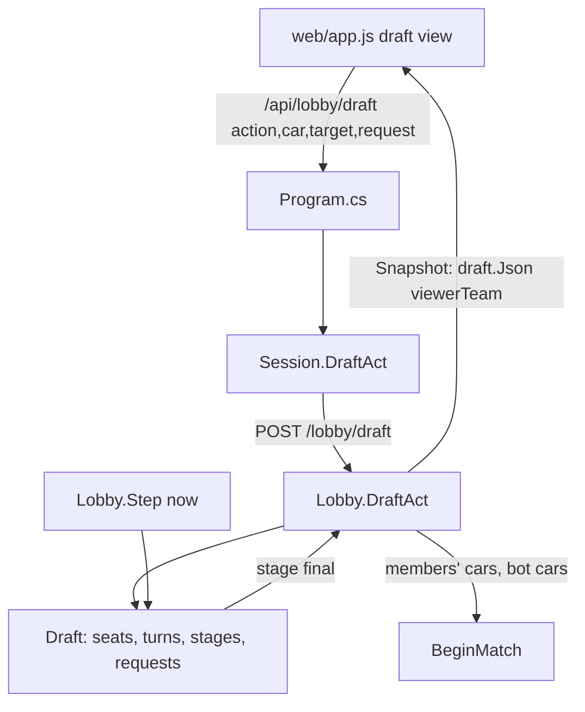

# LoL-style Lobby Draft Design

**Spec**: `.specs/features/lol-draft/spec.md`
**Status**: Approved (the owner approved the design page and asked to implement it)

---

## Architecture Overview

The draft stays a launcher-only feature, hosted by the lobby (`Lobby.cs`) and shown by the launcher page. A new `SeatDraft` class replaces `Draft` as a self-contained state machine over seats (positions) instead of teams; the lobby maps members to seats, feeds it time through its existing `Step(now)` clock and turns its end into the match. The page gets a full-window draft view.



Approaches considered: (1) rewrite `Draft` as a seat-based machine with injected time (chosen: testable with `Lobby.Step(now)` like the rest of the lobby, keeps `Lobby` thin); (2) keep the team-turn `Draft` and add per-player layers in `Lobby` (rejected: two sources of truth for turns); (3) move the draft to the page and let clients agree (rejected: the lobby is the authority and the cloud runs it remotely).

---

## Code Reuse Analysis

### Existing Components to Leverage

| Component | Location | How to Use |
| --------- | -------- | ---------- |
| Lobby clock `Step(DateTime now)` | `tools/Launcher/Lobby.cs` | Drives draft stages and timeouts; tests call it with their own time |
| Long-poll `Changed()` / `WaitChange` | `tools/Launcher/Lobby.cs` | Every draft change pushes the new state to members at once |
| `/lobby/draft` route, `Session.DraftAct`, `/api/lobby/draft` | `Lobby.cs`, `Session.cs`, `Program.cs` | Same route, extra `target` and `request` fields |
| Skin save `/api/settings {skin, skinCar}` then `SendChoices` | `Program.cs`, `Session.cs` | Skin chosen in the big car view |
| Skin pictures `/img/skins/<car>-<skin>.jpg`, `skinsOf`, `skinPic` | `Program.cs`, `web/app.js` | Car squares and the big preview |
| Test lobby setup (`BuildReady`, `StartServerHook`, `Paths.Init`) | `tools/Launcher.Tests/HostRoutesTests.cs` | Lobby-level draft tests without a game |

### Integration Points

| System | Integration Method |
| ------ | ------------------ |
| Match server | `BotCars(team)` returns the bot seats' picked cars in position order |
| Cloud lobbies | No new route: the cloud lobby is the same `Lobby`; a 1.8 server image is needed later (out of scope) |
| Host setup | `draftBans`/`draftPicks` dropped from `SetupJson` and ignored in `LoadSetup` |

---

## Components

### SeatDraft (replaces Draft)

- **Purpose**: The whole draft of one match: seats, the fixed order, stages, marks and locks, bots, timeouts, swap and trade requests, and what each team sees.
- **Location**: `tools/Launcher/SeatDraft.cs` (the old `Draft.cs` is deleted when the lobby switches to it, so every task keeps the project building)
- **Interfaces**:
  - `SeatDraft(string first, Dictionary<string, List<string>> seats, IEnumerable<string> cars, int turnSeconds, DateTime now, int planSeconds = 15, int finalSeconds = 20)` - seats: member id per position (null = bot), positions in order.
  - `static List<Turn> Order(string first, int firstSeats, int secondSeats)` - the fixed order minus missing positions.
  - `string Mark(string team, int pos, string car)`, `string Lock(string team, int pos)` - null or the error text from the spec.
  - `bool Tick(DateTime now, Random rng, Func<string, bool> gone)` - planning end, bot actions, timeouts, request expiry, finalization end; true when something changed.
  - `string AskSwap(string team, int from, int to, DateTime now)`, `string AskTrade(...)`, `string Answer(string team, int pos, int request, bool accept)`.
  - `Dictionary<string, object> Json(string viewerTeam, DateTime now)`.
  - `string Stage` ("plan", "turns", "final", "done"), `Seat Find(string memberId, out string team)`, `List<string> BotCars(string team)`.
- **Dependencies**: none (pure, time passed in).
- **Reuses**: the existing `Draft` shape (turn list, `Available`, JSON for a viewer team).

### Lobby draft wiring

- **Purpose**: Start the draft from the lobby's members and bots, route member actions, follow stages in `Step`, give players and bots their cars, start the match after finalization.
- **Location**: `tools/Launcher/Lobby.cs`
- **Interfaces**: `DraftAct(string token, string action, string car, string target, int request)`; `BeginDraft`, `DraftFollow(now)`, `BotCars(team)` changed.
- **Reuses**: `Changed()`, `BeginMatch`, `CantStart`, `Players`, `BotsOn`.

### Client plumbing

- **Purpose**: Carry `target` and `request` from the page to the lobby.
- **Location**: `tools/Launcher/Session.cs`, `tools/Launcher/Program.cs`.

### Draft view (page)

- **Purpose**: Full-window draft: two team columns of position cards, the car grid with pictures, turn chips, clock, requests, the big car with skins, ready button.
- **Location**: `tools/Launcher/web/index.html`, `web/app.js`, `web/style.css`, `web/i18n.js`.
- **Reuses**: `paint`, `act`, `skinsOf`, `skinName`, `S.images`, the `/img/skins` pictures; marks a clicked car locally before the answer (optimistic).

---

## Data Models

```csharp
class Seat { string Member; string Mark, Intent, Ban, Car; bool Locked; } // Member null = bot; Intent = car marked outside one's turn
class Turn { string Team; bool Pick; List<int> Positions; }             // positions are 1-based
class Request { int Id; string Kind /* swap, trade */, Team; int From, To; DateTime Expires; }
```

Draft JSON for a viewer team:

```json
{ "first": "blue", "stage": "turns", "step": 2, "done": false, "secondsLeft": 24,
  "turns": [{ "team": "blue", "pick": false, "positions": [1] }],
  "seats": { "blue": [{ "pos": 1, "id": "ab12", "bot": false, "ban": "19", "car": "", "mark": "", "locked": true }], "red": [] },
  "bans": [{ "car": "19", "team": "blue" }], "picks": [{ "car": "10", "team": "blue" }],
  "requests": [{ "id": 3, "kind": "swap", "from": 2, "to": 3, "secondsLeft": 7 }] }
```

`mark` is empty for the other team; `requests` only lists the viewer team's.

---

## Risks & Concerns

| Concern | Where | Mitigation |
| ------- | ----- | ---------- |
| The old `Draft` had no unit tests; the lobby draft flow is untested | `Draft.cs`, `Lobby.cs` | New `DraftTests` and `LobbyDraftTests` cover the spec before the UI work |
| `app.js` is one 1,170-line file with string-built HTML | `web/app.js` | Keep the draft view in its own functions; no JS test infrastructure exists, so the page is checked by hand (UAT) |
| A member removed mid-draft (lost connection) leaves a seat pointing at a gone id | `Lobby.Step` | `Tick` gets a `gone(id)` check and plays that seat as a bot |
| Cloud lobbies run the launcher inside the server image | cloud | 1.8 lobbies need a new image; listed as a release step, not done here |
